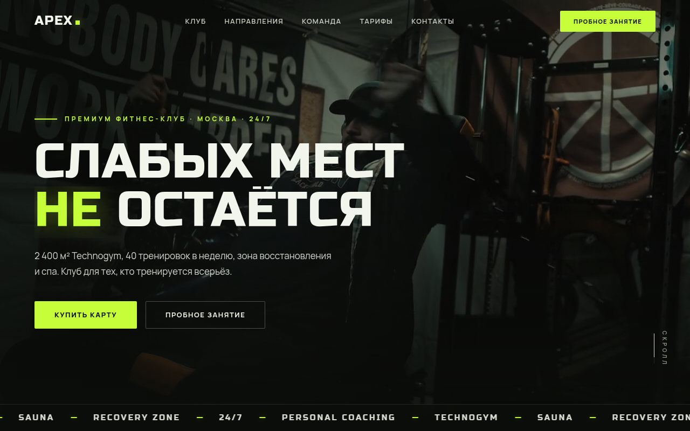
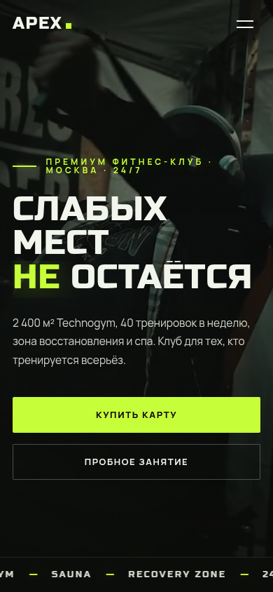

# APEX — концепт-сайт премиум фитнес-клуба

## Демо

**[Открыть сайт →](https://shalim-andrej.github.io/apex/)**




Премиальный одностраничник вымышленного фитнес-клуба APEX: круглосуточный формат 24/7, тренажёры Technogym, СПА-зона. Самый насыщенный по контенту проект пятёрки — клуб, направления, команда, расписание, тарифы и отзывы на одной странице.

**Демо:** [shalim-andrej.github.io/apex](https://shalim-andrej.github.io/apex/)

## Визуальный язык

- Строгая «дорогая» палитра, спортивная пластика заголовков
- Видео-обложка в первом экране
- Акцент на факты доверия: 24/7, Technogym, СПА
- Плотная сетка блоков с контрастными крупными цифрами

Каждый проект в премиум-пятёрке имеет собственную сетку и палитру — APEX отвечает в связке за «энергию и премиальность спорта».

## Структура страницы

| Блок | Содержание |
|---|---|
| Первый экран | видео-обложка, позиционирование клуба |
| Клуб | 24/7, Technogym, СПА — факты доверия |
| Направления | программы тренировок |
| Команда | тренеры и квалификация |
| Тарифы | карты и абонементы |
| Расписание | занятия по дням |
| Отзывы | члены клуба |
| Запись | форма: имя, телефон, направление, тариф |

## Что внутри технически

- **HTML5-видео** в hero-секции
- **Glassmorphism** — панели и карточки на `backdrop-filter`
- **Параллакс** — слои, привязанные к скроллу
- **Reveal-анимации** на IntersectionObserver + расширенный набор кастомных `@keyframes`
- **CSS Grid** и кастомные свойства, fluid-типографика на `clamp()`
- **Адаптив** всех блоков, `loading="lazy"` для изображений
- **Open Graph** разметка (9 тегов) и `meta description` — лучшая SEO-упаковка в пятёрке
- **Ноль зависимостей** — vanilla JS, стили и скрипты написаны с нуля

## Запуск локально

```bash
git clone https://github.com/shalim-andrej/apex.git
cd apex
```

Откройте `index.html` в браузере — сборка и зависимости не нужны.

## Автор

Разработчик — Андрей Шалимов ([@shalim-andrej](https://github.com/shalim-andrej)).
Заказать сайт: [Kwork](ССЫЛКА_НА_ПРОФИЛЬ_KWORK)

> Проект демонстрационный: бренд вымышленный, сайт создан как портфолио-кейс.